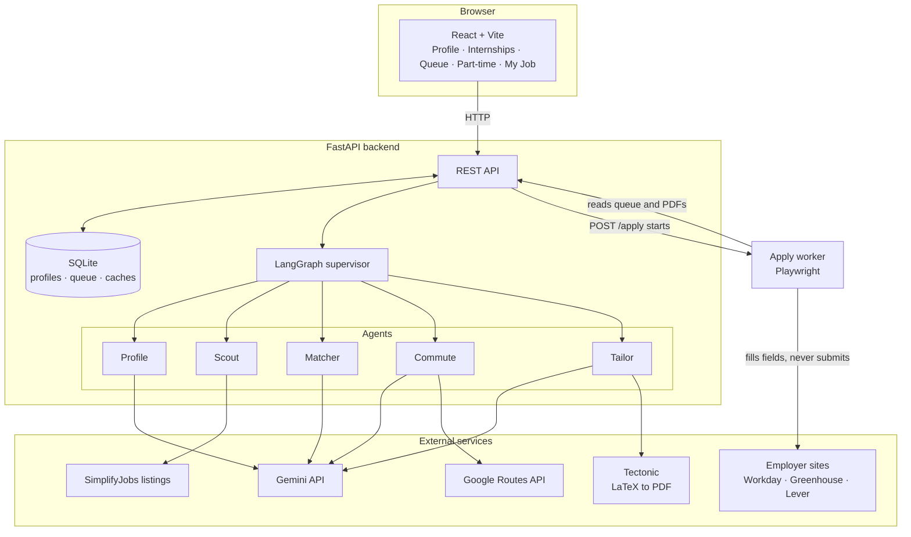
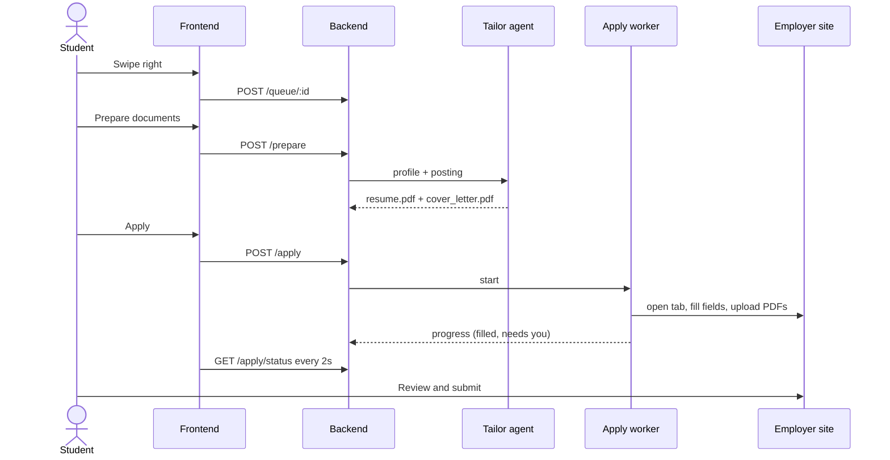

<p align="center">
  
</p>

<h3 align="center">Aim. Swipe. Hired.</h3>

<p align="center">
  Built at HackJam 2026, University of South Florida<br>
  <a href="https://www.mlh.com/events/hackjam-26/submissions/01a20051-2349-59b3-2d7b-1e63410c8229">View our MLH submission</a>
</p>

---

BullsI finds USF students internships and part-time jobs that fit around their classes, then does the tedious part of applying. You upload a resume and a screenshot of your class schedule once. From there, a set of agents ranks live internships, tailors your resume and cover letter for the ones you pick, and fills out the applications in browser tabs so you only have to review and submit.

Part-time jobs work differently. Any job with a shift that overlaps a class is hidden, and the rest are ranked partly by how easy they are to reach by bus. Each one shows the route, when to leave, the fare (HART is free for USF students), and how much CO2 you save compared with driving.

## How it works

1. **Profile.** Gemini reads your resume PDF and schedule screenshot and returns a structured profile. Every resume bullet gets an id so later steps can only reuse what you actually wrote.
2. **Internships.** Live listings are filtered by work authorization, scored in plain Python, and shown one card at a time with a short reason from Gemini. Swipe right to save.
3. **Documents.** For each saved internship, BullsI picks and lightly rewords your real bullets, writes a cover letter, and compiles both to PDF with LaTeX.
4. **Apply.** One click opens a tab per job and fills what it can. Blank fields are outlined and listed in a checklist. Submitting is always up to you.
5. **Part-time.** Jobs that conflict with your classes are hidden. The rest show commute time, a car-free badge, and a route map.
6. **My Job.** Once you're hired, add your shifts to get a leave-by time for each one, a calendar file with reminders, and a chat for "I missed my bus, what now?"

## Architecture



The backend is one FastAPI app. Each request that needs agents goes through a LangGraph state graph that holds the profile, ranked jobs, queue and generated documents. Expensive results (rankings, PDFs, transit routes) are cached in SQLite per profile, so repeat requests come back in well under a second. The apply worker runs as its own process because it drives a real browser and shouldn't block the API.

### What happens when you apply



### Agents

| Agent | Responsibility | Uses Gemini for |
| --- | --- | --- |
| Profile | Resume PDF and schedule screenshot to a structured profile | Reading PDFs and images, JSON output |
| Scout | Pulls internships and part-time jobs into one job format | |
| Matcher | Hard gates (work authorization, class conflicts), then a 0 to 100 score | One batched call for match reasons |
| Commute | Transit route per job, car-free badge, CO2, leave-by times | Function calling in the missed-bus chat |
| Tailor | Chooses and rewords real bullets, writes the cover letter | JSON output, URL context for job descriptions |
| Apply | Opens and fills application tabs | |

Scoring, schedule conflicts and CO2 math are plain Python, not model output, so the numbers are repeatable and testable.

## Design decisions

**The model never invents experience.** The Tailor returns bullet ids, not free text. Any id that isn't in the profile is rejected, and a reworded bullet that adds a new number or tool is replaced with the original.

**Nothing gets submitted for you.** The apply worker can only click an allowlist of navigation buttons. It never clicks Submit, never types into password fields, and never answers voluntary demographic, veteran or disability questions. Fields the profile can't answer stay blank instead of being guessed.

**Commutes start where students actually are.** If your profile only has a city, routes start from the Marshall Student Center. Intercity buses are filtered out so a 17 minute walk doesn't turn into a FlixBus ride.

**Fares are real.** HART Local, Limited Express and HARTFlex are free for USF students with a Flamingo Card, so most routes show $0. CO2 savings use the EPA's per mile figure for a typical passenger car.

## Running locally

You'll need Python 3.11+, Node 18+, [Tectonic](https://tectonic-typesetting.github.io/), a [Gemini API key](https://aistudio.google.com/), and a Google Cloud key with the Routes API and Maps JavaScript API enabled.

```bash
git clone https://github.com/omarrifaie/Hackjam.git
cd Hackjam
```

Create `.env` in the repo root and `frontend/.env`:

```bash
# .env
GEMINI_API_KEY=
GOOGLE_MAPS_API_KEY=
TECTONIC_PATH=                # only if tectonic isn't on your PATH
BULLPEN_APPLY_URL_OVERRIDE=   # optional: send every apply tab to one URL, e.g. the mock portal

# frontend/.env
VITE_API_URL=http://localhost:8000
VITE_GOOGLE_MAPS_KEY=         # restrict this key to your site's address
```

**Backend**

```bash
cd backend
python -m venv .venv
.venv/Scripts/pip install -r requirements.txt      # macOS/Linux: .venv/bin/pip
.venv/Scripts/python -m uvicorn main:app --port 8000
```

API docs are at http://localhost:8000/docs.

**Frontend**

```bash
cd frontend
npm install
npm run dev
```

Open http://localhost:5173.

**Apply worker**

```bash
cd apply_worker
python -m venv .venv
.venv/Scripts/pip install -r requirements.txt
.venv/Scripts/python -m playwright install chromium
```

The backend starts the worker when you click Apply. To try it without touching a real employer site, open the mock portal at http://localhost:5173/mock-workday/demo, or set `BULLPEN_APPLY_URL_OVERRIDE` to that address.

**Warming the cache before a demo**

```bash
cd backend
.venv/Scripts/python scripts/warm_demo.py
.venv/Scripts/python -m tools.b_setup warm
```

## Tests

```bash
cd backend && .venv/Scripts/python -m pytest -q
cd apply_worker && .venv/Scripts/python -m pytest tests
cd apply_worker && .venv/Scripts/python -m pytest tests --mock-url http://localhost:5173/mock-workday/demo
cd frontend && npm run build
```

Gemini and Google Routes are mocked in the test suites. The apply worker suite checks each safety rule directly, including that Submit is never clicked.

## Repo layout

```
backend/        FastAPI app, LangGraph graph, agents, LaTeX templates, tests
apply_worker/   Playwright worker, field map, mock application page, tests
frontend/       React app
```

`backend/README.md` has the full route list.

## Credits

Internship data comes from [SimplifyJobs](https://github.com/SimplifyJobs/Summer2027-Internships). Transit routing uses the [Google Routes API](https://developers.google.com/maps/documentation/routes/transit-route). Fare rules come from [USF Transportation](https://www.usf.edu/transportation). The part-time listings in this repo are sample data.

## Team

Omar Rifaie · Ankith Talpady · Clemente Varela Lira

## What's next

The USF Bull Runner isn't in Google's transit data, so the campus shuttle leg is the first thing to add from its own feed. After that: verifying the apply worker on more real Workday, Greenhouse and Lever forms, and push reminders before each shift.
